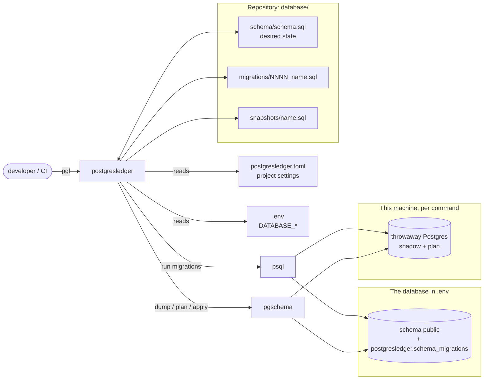
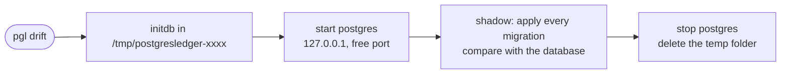
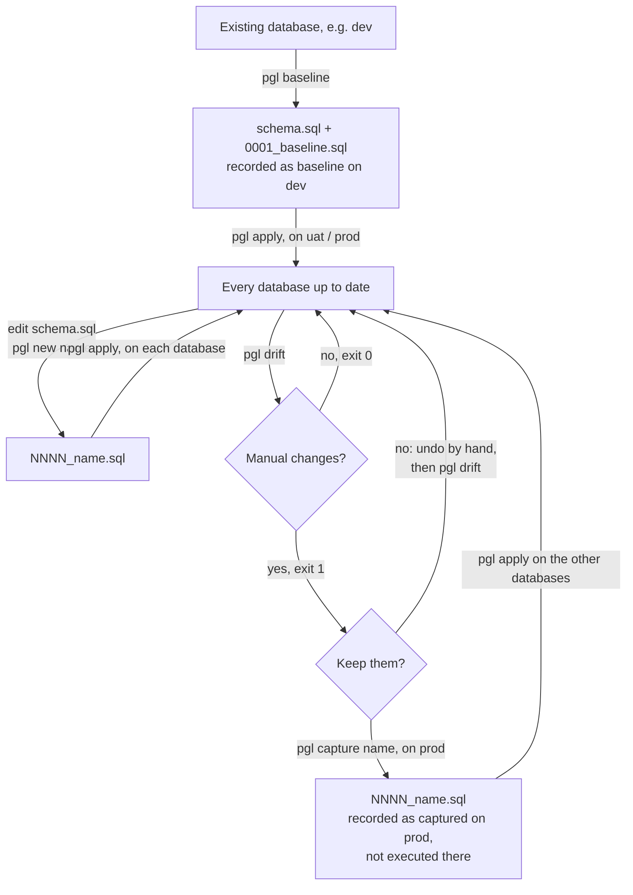
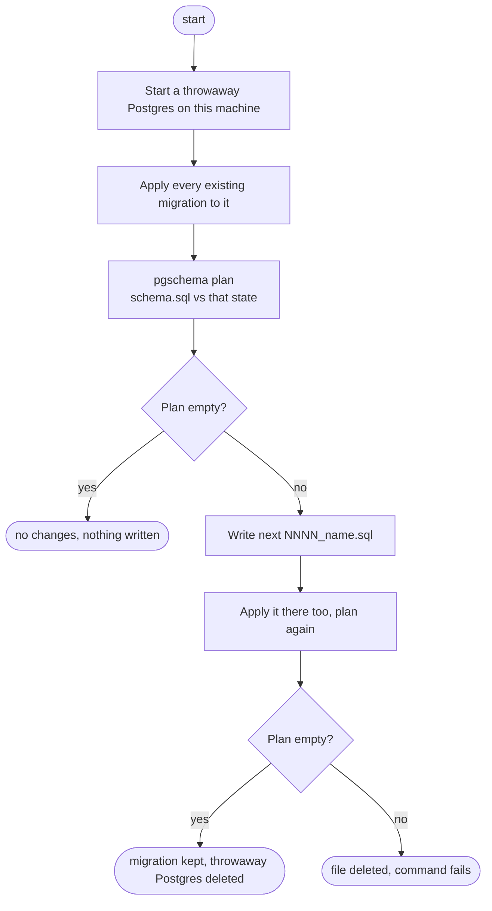
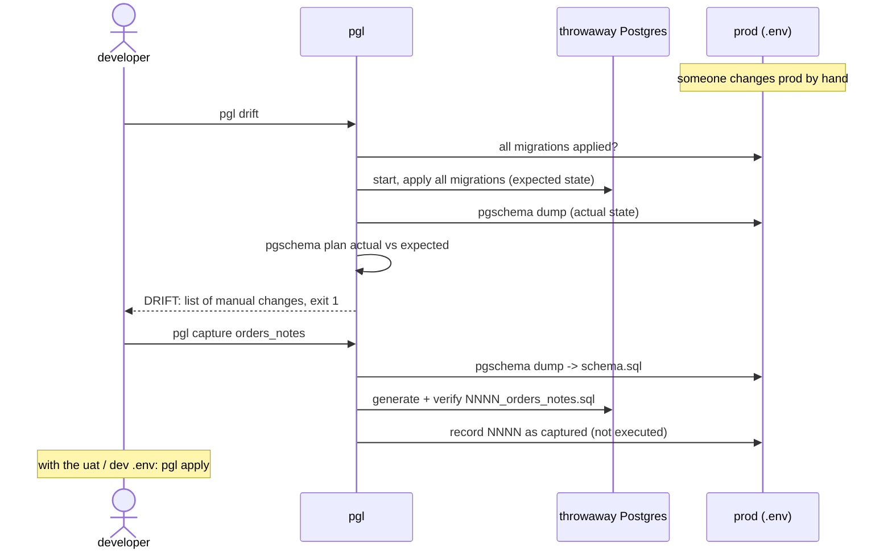
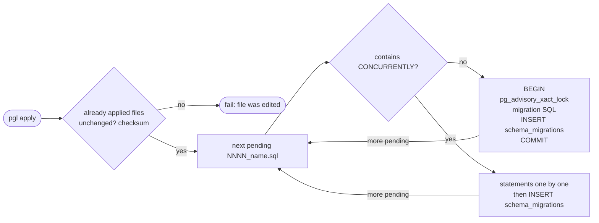

# postgresledger

[](https://pypi.org/project/postgresledger/)
[](https://pypi.org/project/postgresledger/)
[](https://github.com/nmrkic/postgresledger/actions/workflows/tests.yml)
[](https://github.com/nmrkic/postgresledger/blob/main/LICENSE)

Versioned migrations for PostgreSQL from plain SQL, without an ORM (tables,
views, materialized views, functions, triggers), built on
[pgschema](https://www.pgschema.com). The command is `pgl`.

`pgl` works on **one database per run**: the `DATABASE_*` variables from `.env`
(or the environment). Every database records which migrations it has; the
tool never needs to know about the others.

How it works, layout and rules:
[`docs/architecture.md`](https://github.com/nmrkic/postgresledger/blob/main/docs/architecture.md).

## What it does

- **Baseline** — dumps an existing database into `database/schema/schema.sql`
  and `0001_baseline.sql`, so an empty database can be recreated from it.
  A database that already has the same schema is recorded as up to date.
- **Migrations** — edit `schema.sql`, run `pgl new <name>`, get the next
  `NNNN_name.sql` (verified before it is kept).
- **Apply** — runs the pending migrations and records them in
  `postgresledger.schema_migrations` on the database.
- **Drift** — compares the database with what its migrations say it should
  be, and lists changes made by hand.
- **Capture** — keep a manual change: a new migration, recorded as already
  there on that database. (There is no command that drops manual changes on
  a database; that is done by hand or with a normal migration, on purpose.)
- **Snapshot / compare** — save a database's schema to a file and list the
  differences between two databases, object by object.

On the server, postgresledger only ever creates its tracking schema. Everything
that needs a scratch database (building "all migrations applied",
generating, drift, capture) runs in a throwaway Postgres on the
machine running `pgl`, deleted after each command (see
[Scratch Postgres](#scratch-postgres)).

## How it works

### Components



### Scratch Postgres

Some commands need a database that can be dropped and recreated: `new`,
`drift`, `capture` and `baseline` build "every migration applied"
in one. That never happens on a real server, and it doesn't use Docker
either. pgl runs Postgres directly, as an ordinary process under your user:

- **Once per machine**, `pgl setup` downloads a ready-made Postgres 17 build
  (the server programs and their libraries, from the
  [zonky](https://github.com/zonkyio/embedded-postgres-binaries) project)
  and unpacks it into `~/.cache/postgresledger/postgres-<version>/`. Nothing is
  installed system-wide; no root, no `apt`, no Docker.
- **Per command**, pgl runs `initdb` into a fresh temp folder, starts the
  server on `127.0.0.1` on a random free port (not reachable from outside
  the machine), does its work in it, then stops it and deletes the folder,
  also when the command fails.



It takes about a second; afterwards no process, file or port is left. `apply`,
`status`, `snapshot` and `compare` don't start it. It cannot run as root
(Postgres refuses to), and needs Linux or macOS on amd64 or arm64.

Why not Docker: it would have to be installed and running everywhere `pgl`
runs (CI runners, servers), many of those don't allow it, and a container
starts slower than a local process.

### Workflow

Each arrow runs with the `.env` of the database it acts on.



### Generating a migration (`baseline`, `new`, `capture`)



`baseline` dumps the database into `schema.sql` first and records `0001` as
`baseline` there; `capture` dumps the database into `schema.sql` first and
records the new migration as `captured` there. `new` does not touch the
database at all.

### Drift and capture



### Apply



## Install

Requires Python 3.11+ and `psql`. `pgl init` / `pgl setup` download the rest
once per machine into `~/.cache/postgresledger/`: pgschema and a Postgres
server for the throwaway scratch databases (both pinned, SHA256 checked).

```bash
uv tool install postgresledger      # or: pipx install postgresledger
pgl --version
```

| OS | Install the prerequisites |
|---|---|
| Linux (Debian/Ubuntu) | `sudo apt install python3 postgresql-client` |
| macOS | `brew install python libpq && brew link --force libpq` |
| Windows | no pgschema build — use [WSL2](https://learn.microsoft.com/windows/wsl/install) and follow the Linux row |

Supported: Linux and macOS, amd64 and arm64. The scratch Postgres cannot
run as root (run `pgl` as a normal user, also in CI containers). To bump
pgschema or the scratch Postgres, change `VERSION` and the hashes in
`src/postgresledger/pgschema.py` / `src/postgresledger/scratch.py`.

## Usage

In the project that owns the database:

```bash
pgl init                       # postgresledger.toml, .env (git-ignored), database/schema/, database/migrations/
# set the DATABASE_* variables in .env (see below)

pgl baseline                   # 1. snapshot the existing database as 0001_baseline

# 2. edit database/schema/schema.sql, then
pgl new add_loyalty_and_coupons
pgl apply                      # --dry-run to preview
pgl status

# 3. someone changed the database by hand
pgl drift                      # exit code 1 on drift
pgl capture orders_notes       # keep it: other databases get it with `pgl apply`
                               # or undo it by hand, then `pgl drift` again

# 4. how do two databases differ?
pgl snapshot prod              # with prod's .env -> database/snapshots/prod.sql
pgl snapshot uat               # with uat's .env
pgl compare uat prod           # or `pgl compare prod`: the snapshot vs the database itself
```

The database comes from these variables in `.env`:

```bash
DATABASE_HOST=localhost        # default: localhost
DATABASE_PORT=5432             # default: 5432
DATABASE_USER=postgres         # default: postgres
DATABASE_PASSWORD=secret       # default: empty
DATABASE_NAME=app              # required
DATABASE_SSLMODE=require       # default: prefer
```

Each server or CI job has its own `.env`, or sets the variables in its
environment; a variable set there wins over `.env`. `pgl --env-file .env.uat …`
(or `PGL_ENV_FILE=.env.uat`) picks another file for one run.
Run `pgl` in the folder with `postgresledger.toml`, or point to it with
`--config PATH`. `pgl <command> -h` describes each command.
`baseline`, `new`, `capture` and `drift` print only what changed;
`--verbose` (`-v`) prints pgschema's whole plan, SQL included. On every
command that dumps a database (also `snapshot` and `compare`), `--verbose`
shows pgschema's log as it connects: when a run hangs, it tells whether the
connection or the dump is slow.

## Several schemas

By default `pgl` manages one schema, `public`, with its desired state in
`schema.sql`. To manage several schemas of the same database, list them in
`postgresledger.toml` instead of `schema` and `schema_file`:

```toml
[project]
schemas = ["public", "billing"]
schema_dir = "database/schema"     # public.sql, billing.sql (the default)
```

Each schema has its own file of desired state, and every command works on
all of them: one `pgl new`, one `pgl apply`, one `pgl drift`. A migration
covers every schema that changed, one part per schema in the order of
`schemas`:

```sql
-- schema: public
SET search_path TO public;
...
-- schema: billing
CREATE SCHEMA IF NOT EXISTS billing;   -- only in the first migration that has billing
SET search_path TO billing;
...
```

pgschema writes a schema's own objects without the schema name and other
schemas' objects with it (`REFERENCES public.customer (id)`), which is why
each part sets `search_path`. Snapshots hold every schema too, and `compare`
names the objects `<schema>.<name>`.

List a schema after the schemas it refers to: a view in `billing` on
`public.customer` needs `public` first. References in both directions
between two schemas are not supported.

A schema added to `schemas` that already exists in the databases with
objects in it: `pgl capture <name>` on one of them takes it into the schema
files and records the migration as captured there. The other databases that
already have the schema cannot run that migration, and `pgl` has no command
yet to record it there without running it.

## Roles and grants

Roles (database users and groups) belong to the whole Postgres server and
usually differ between databases: other users on dev and prod, the roles a
managed database adds. pgschema never creates them. If grants were part of
the migrations, `pgl apply` would fail on a database without one of the
roles, and grants that differ on purpose would show up in `drift` and
`compare`.

So `pgl init` writes a `.pgschemaignore` next to `postgresledger.toml` that
leaves every grant and default privilege out of `schema.sql`, the migrations
and the snapshots:

```toml
[privileges]
patterns = ["*"]

[default_privileges]
patterns = ["*"]
```

The patterns are the names of the roles that receive the grants:
`["*", "!app_reader"]` keeps only the grants to `app_reader`, `["cloudsql*"]`
leaves out only the grants to `cloudsql*` roles. Delete the file to keep
every grant in the migrations. pgschema reads it from the folder `pgl` runs in,
on every command; more in the
[pgschema docs](https://www.pgschema.com/cli/ignore).

## Developing postgresledger

Needs [uv](https://docs.astral.sh/uv/) and Docker. This repository is also
the tool's test bed: a local Postgres in `docker/`
with `dev`, `stage` and `prod`, and demo data in `database/seed/`. `.env`
points at `dev`; `make <target> ENV=stage` runs one command on another
database, and `make apply-all` / `drift-all` / `status-all` /
`snapshot-all` loop over the three.

```bash
make setup        # uv sync + pgl setup
make up           # postgres:17 on localhost:55432
make seed         # demo schema + data into dev
make test         # unit tests + the full flow against the local Postgres
```

`make help` lists every target; `make reset` starts from scratch (empty
Postgres, seeded dev, no schema, migrations or snapshots).

## License

MIT, see [LICENSE](https://github.com/nmrkic/postgresledger/blob/main/LICENSE).
